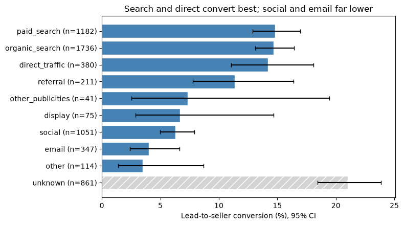
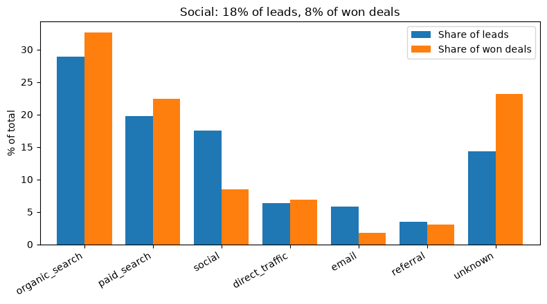
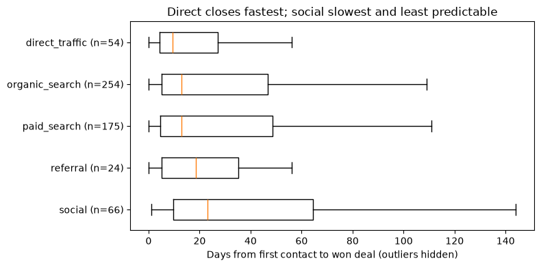
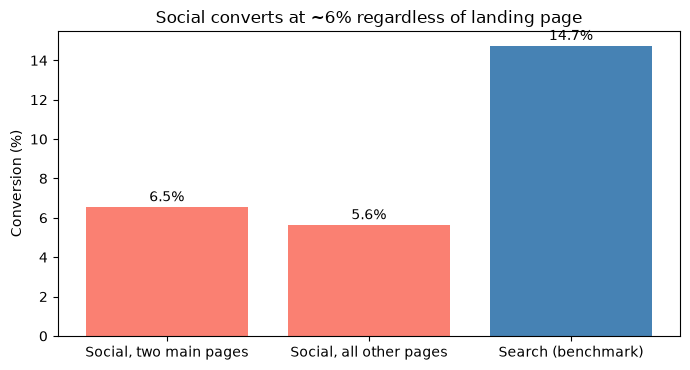

# Which lead channels turn merchants into paying sellers? An Olist marketing funnel analysis

**Search and direct leads convert about 2-4x better than social and email leads, and they close faster. Nearly a quarter of all won deals have no recorded origin.**



## Business question

Olist connects small merchants to online marketplaces. Its marketing and sales team gets "marketing qualified leads" (merchants who ask to be contacted) and tries to turn them into paying sellers.

This project asks:

1. Which lead channel is most effective at turning merchants into paying sellers?
2. How long does it take (the sales cycle)?
3. Where should the team focus its effort?

## Key findings

Cohort: **5,998 leads** first contacted between January and May 2018. **781 (13.0%)** became sellers.

1. **Search and direct traffic convert best.** Paid search (14.8%), organic search (14.7%), and direct traffic (14.2%) are statistically indistinguishable, so the data cannot say one beats another.
2. **Social and email convert poorly.** Social converts at 6.3% and email at 4.0%. Social is 18% of leads but only 8% of won deals.

   

3. **Social is also the slowest.** Median time from first contact to win is 9.5 days for direct, 13 for search, and 23 for social. Only 33% of social deals close within two weeks, versus 53% for search and 67% for direct.

   

4. **Social's weakness is the channel, not the landing page.** Social leads convert at about 6% on every landing page, including pages where search traffic does well.

   

5. **Segment and lead type barely affect speed.** Most business segments close in a median of 9.5-13 days. Audio/video electronics (18.5 days) is somewhat slower.
6. **Origin tracking has a gap.** 14% of leads have no recorded origin, yet they convert at 21% and account for 23% of won deals. About 63% of them came through a single landing page.

## Recommendations

1. **Prioritize search and direct.** They deliver the most sellers per lead and close fastest.
2. **Review social before scaling it.** Investigate why social leads rarely convert (for example, targeting or qualification), and test a change before increasing spend.
3. **Fix origin tracking.** Find out how the roughly 860 unknown-origin leads arrive, so the best-converting group can be traced and optimized.
4. **Review one underperforming landing page.** Page `e492ee5e` converted at 4.2% on 214 leads despite mostly search, direct, and email traffic.

## Data

Source: [Marketing Funnel by Olist](https://www.kaggle.com/datasets/olistbr/marketing-funnel-olist) on Kaggle.

| File | Contents | Rows |
|---|---|---|
| `olist_marketing_qualified_leads_dataset.csv` | One row per lead: first contact date, landing page, origin | 8,000 |
| `olist_closed_deals_dataset.csv` | Leads that became sellers: won date, segment, lead type, sales rep and other details | 842 |

A lead is "won" if its `mql_id` appears in the closed-deals file. The sales cycle is the number of days from `first_contact_date` to `won_date`, for won leads only.

The raw data is not included in this repository. Download it from Kaggle and place the two CSVs in `data/raw/`.

## Method and data quality decisions

- **Cohort:** only leads first contacted January-May 2018 are analyzed. The deals file starts in December 2017, so earlier leads that converted are missing, which would make their conversion look falsely low. The cohort is defined by contact date, then joined to deals.
- **Dropped columns:** `has_company`, `has_gtin`, `average_stock`, and `declared_product_catalog_size` are about 92% null. They were only collected for deals won from July 2018 onward.
- **`declared_monthly_revenue`:** 94.7% of values are 0, read as "not declared" rather than zero revenue, so the column was excluded.
- **Unknown origin:** missing origins were merged into `unknown`. It is reported separately and not ranked as a channel.
- **Negative sales cycle:** deals with a won date before first contact were flagged as data errors and excluded from cycle analysis.
- **Statistics:** conversion rates are shown with 95% Wilson confidence intervals. Sales cycles are summarized with the median and the 25th-75th percentile range, because the distribution is heavily skewed. Groups with fewer than 20 won deals are not compared.

## Limitations

- The dataset is a sample of leads, so findings are directional.
- There is no cost data, so results show conversion, not return on investment.
- Conversion is not seller quality. Whether leads from different channels become good sellers needs the orders data.
- Landing pages are anonymized, so differences between pages cannot be explained.
- Cycle times cover won deals only, and leads contacted later had less time to close.
- Lead type and segment exist only for won deals, so they cannot explain conversion.

## How to reproduce

```
olist-marketing-funnel-analysis/
├── data/raw/                              # the two CSVs (download from Kaggle)
├── figures/                               # charts used in this README
├── olist_funnel_analysis.ipynb   # full cleaning and analysis
└── README.md
```

1. Create an environment and install the requirements: `pip install -r requirements.txt` (pandas, matplotlib, statsmodels, jupyter).
2. Place the two raw CSVs in `data/raw/`.
3. Run `olist_funnel_analysis.ipynb` from top to bottom

## Next steps

- Join with the Olist orders dataset (via `seller_id`) to compare seller performance by channel.
- Add acquisition cost data to estimate cost per acquired seller.

## Author

TH
